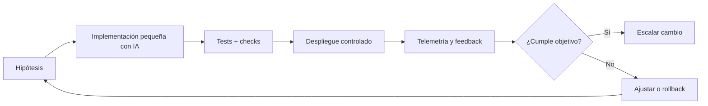
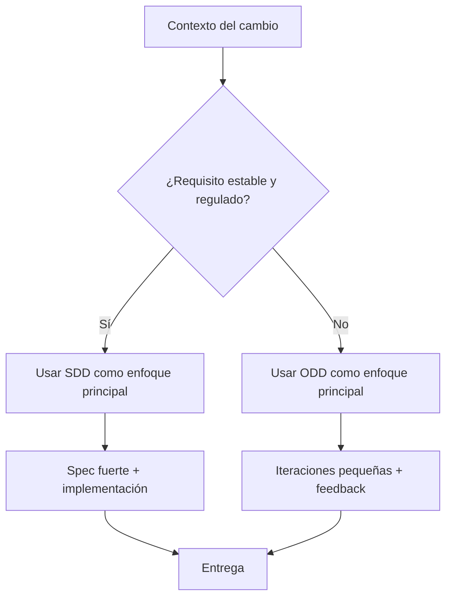

# Organic-Driven Development (ODD) con IA

Guía práctica para evolucionar software con IA de forma incremental, adaptable y orientada al feedback real.

## 📌 Resumen

- **Dificultad**: Avanzado
- **Tiempo de lectura**: 20 minutos
- **Última actualización**: 2026

## Introducción

Organic-Driven Development (ODD) es un enfoque de desarrollo donde el sistema crece por iteraciones pequeñas, guiadas por señales reales: uso de usuarios, métricas de producción, fallos observados y aprendizaje continuo del equipo.

En desarrollo con IA, ODD es especialmente útil cuando el dominio cambia rápido o no existe una especificación estable al inicio. En vez de definir todo por adelantado, ODD prioriza hipótesis pequeñas, entregas frecuentes y adaptación continua.

Mientras SDD fija una especificación fuerte al principio, ODD acepta que parte del conocimiento aparece durante la ejecución. Por eso ambos enfoques son complementarios.

## Conceptos básicos

ODD con IA se apoya en cinco principios:

1. **Incrementos pequeños**: cambios mínimos, frecuentes y reversibles.
2. **Feedback temprano**: decisiones basadas en telemetría, tests y uso real.
3. **Evolución guiada por evidencia**: la IA propone, pero la evidencia decide.
4. **Arquitectura adaptable**: diseño modular para cambiar sin romper todo.
5. **Aprendizaje continuo**: cada iteración produce código y conocimiento reusable.

Ejemplo de ciclo ODD en formato de hipótesis:

```yaml
hypothesis: "Si reducimos fricción en onboarding, sube la activación un 10%"
change:
  - "Simplificar formulario de registro"
  - "Añadir asistente guiado con IA"
measurement:
  - "activation_rate"
  - "dropoff_step_2"
guardrails:
  - "error_rate < 1%"
  - "p95_latency < 400ms"
decision:
  - "promote_if_activation_up"
  - "rollback_if_guardrail_breaks"
```

## Paso a paso

### Paso 1: Definir un ciclo ODD operativo

En ODD con IA, la unidad principal no es la “gran feature”, sino la **iteración verificable**. Cada iteración incluye:

- hipótesis,
- cambio acotado,
- criterio de éxito,
- regla de rollback.

Diagrama del ciclo:



Comandos típicos para una iteración corta:

```bash
# Nueva rama para experimento
git checkout -b exp/onboarding-v2

# Ejecutar tests rápidos antes de subir cambios
npm test -- --watch=false

# Ejecutar linter
npm run lint

# Commit pequeño y trazable
git add .
git commit -m "feat(onboarding): experimento ODD v2 con validación guiada"
git push -u origin exp/onboarding-v2
```

### Paso 2: Aplicar ODD con IA en un flujo real

Una secuencia práctica para usar ODD en un equipo con IA:

1. Definir una hipótesis concreta de producto o técnica.
2. Pedir a IA un cambio mínimo acotado (no una reescritura completa).
3. Añadir métricas y logs antes de desplegar.
4. Activar mediante feature flag o rollout parcial.
5. Evaluar resultados y decidir: escalar, ajustar o revertir.

Ejemplo de prompt para IA en modo ODD:

```markdown
Implementa un cambio mínimo para reducir abandono en el paso 2 del onboarding.

Restricciones:
- No modificar rutas fuera de /onboarding.
- Añadir telemetría para event_onboarding_step2_submitted.
- Mantener compatibilidad con el flujo actual.
- Incluir test unitario del validador y test de integración del endpoint.
- Entregar plan de rollback.
```

Diagrama de decisión ODD vs SDD:



#### Relación entre ODD y SDD

ODD no sustituye a SDD, y SDD no sustituye a ODD:

- **SDD** aporta precisión inicial, contratos y trazabilidad fuerte.
- **ODD** aporta adaptación continua, exploración controlada y aprendizaje rápido.

Patrón híbrido recomendado:

- Usar SDD para partes críticas (contratos API, seguridad, compliance).
- Usar ODD para optimizar UX, rendimiento funcional y decisiones de producto con incertidumbre.

## Mejores prácticas

!!! tip "Consejo"
    Mantén cada iteración ODD pequeña. Si no puedes validar el resultado en pocos días, probablemente el cambio es demasiado grande.

!!! tip "Consejo"
    Define guardrails técnicos antes del despliegue: error rate, latencia, consumo y estabilidad. Sin guardrails, ODD se vuelve ensayo y error sin control.

!!! warning "Advertencia"
    Evita usar ODD como excusa para no diseñar. Aunque el enfoque sea evolutivo, cada iteración debe tener hipótesis, métricas y criterio de decisión.

!!! warning "Advertencia"
    No aceptes propuestas de IA sin validación. En ODD la velocidad importa, pero nunca por encima de pruebas y observabilidad.

## Conclusión

ODD con IA permite evolucionar productos en entornos cambiantes con menor riesgo, porque convierte cada cambio en una hipótesis medible y reversible. Combinado con SDD, puedes mantener control técnico en las zonas críticas y flexibilidad en las zonas de aprendizaje.

En la práctica, los equipos más eficaces suelen operar con un modelo híbrido: SDD para “lo que debe ser exacto” y ODD para “lo que debe mejorar continuamente”.

---

**Recursos relacionados:**
- [Specific-Driven Development (SDD) con IA](./sdd.md)
- [GitHub Actions](https://docs.github.com/actions)
- [Feature Flags](https://martinfowler.com/articles/feature-toggles.html)
