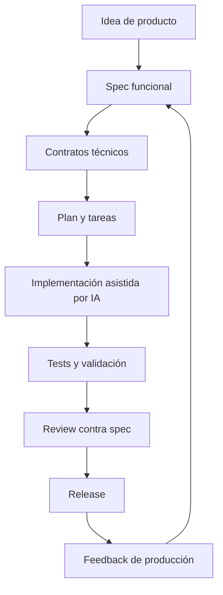
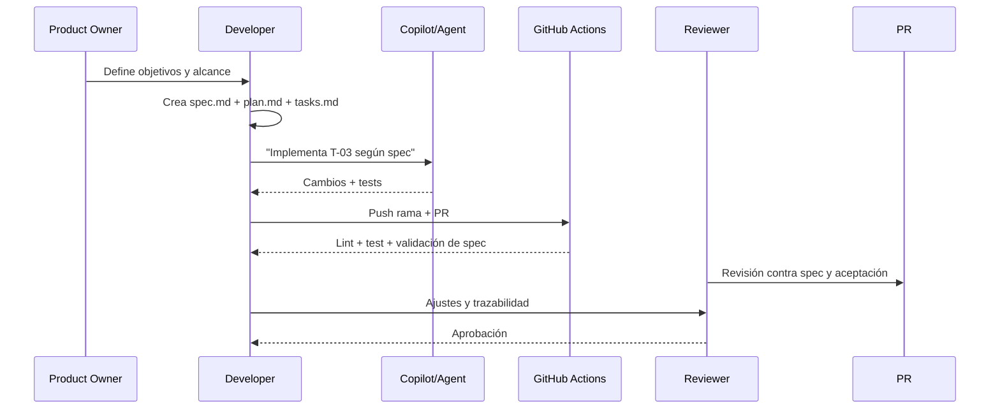

# Specific-Driven Development (SDD) con IA

Guía práctica para diseñar software con especificaciones ejecutables y asistentes de IA.

## 📌 Resumen

- **Dificultad**: Avanzado
- **Tiempo de lectura**: 28 minutos
- **Última actualización**: 2026

## Introducción

Specific-Driven Development (SDD), también conocido como *Spec-Driven Development*, es un enfoque donde la especificación es el artefacto principal del desarrollo: define comportamiento, contratos, restricciones y criterios de aceptación antes del código.

Cuando trabajas con IA (Copilot, agentes de código o LLMs), SDD reduce la ambigüedad. En vez de pedir “haz una API de pedidos”, pides “implementa esta especificación con estos contratos, estos tests y estos criterios de no regresión”. El resultado suele ser más predecible, auditable y fácil de mantener.

## Conceptos básicos

En SDD con IA hay cuatro piezas clave:

1. **Especificación funcional**: qué debe hacer el sistema y qué no.
2. **Contrato técnico**: formato de entradas/salidas (OpenAPI, JSON Schema, GraphQL SDL, Protobuf, etc.).
3. **Criterios verificables**: tests, ejemplos, casos límite y reglas de negocio.
4. **Trazabilidad**: cada cambio de código enlaza con una decisión de especificación.

Una forma sencilla de estructurar un requisito para IA es:

```yaml
feature: "Crear pedido"
inputs:
  - customerId: "uuid"
  - items: "array[OrderItem]"
rules:
  - "items no puede estar vacío"
  - "el total debe ser >= 0"
outputs:
  success: "201 + OrderCreated"
  errors:
    - "400 VALIDATION_ERROR"
    - "409 STOCK_CONFLICT"
acceptance:
  - "si no hay stock, no se crea el pedido"
  - "si el pedido se crea, publica evento order.created"
```

### Ciclo de vida SDD con IA



Este ciclo evita que la IA “adivine” el requisito. La especificación se convierte en contrato de trabajo entre negocio, desarrollo, QA y herramientas de IA.

## Paso a paso

### Paso 1: Definir el tipo de SDD adecuado

Actualmente, en desarrollo con IA se usan varias variantes de SDD. Elegir bien la variante evita prompts ambiguos y retrabajo.

#### 1) API-First SDD

- La fuente de verdad es un contrato como OpenAPI.
- Ideal para microservicios, integraciones y equipos frontend/backend separados.
- La IA genera controladores, clientes y validadores a partir del contrato.

**Comandos típicos**:

```bash
# Validar un contrato OpenAPI
npx @redocly/cli lint openapi.yaml

# Generar cliente TypeScript desde OpenAPI
npx openapi-typescript-codegen --input openapi.yaml --output src/client
```

#### 2) Schema-First SDD

- La base es un esquema de datos: JSON Schema, Avro, Protobuf o GraphQL.
- Útil cuando la estabilidad del dato es crítica (eventos, analítica, pipelines).
- Facilita validación automática y compatibilidad hacia atrás.

**Comandos típicos**:

```bash
# Validar esquemas JSON
npx ajv-cli validate -s schemas/order.schema.json -d examples/order.valid.json

# Compilar contratos protobuf
protoc --proto_path=proto --go_out=gen proto/order.proto
```

#### 3) Behavior-First SDD

- La especificación está orientada a comportamiento y aceptación (Gherkin, ejemplos Given/When/Then, casos de negocio).
- Muy útil para productos con mucha lógica funcional.
- La IA traduce escenarios a tests y luego a implementación.

**Ejemplo Gherkin**:

```gherkin
Feature: Crear pedidos
  Scenario: Rechazar pedido sin stock
    Given que el SKU-123 no tiene stock
    When el cliente intenta crear un pedido con SKU-123
    Then la API responde 409 STOCK_CONFLICT
```

#### 4) Workflow-First SDD

- Se especifican procesos extremos a extremo (estados, transiciones, errores, compensaciones).
- Encaja muy bien en automatizaciones y sistemas distribuidos.
- Permite a la IA generar orquestación y casos de resiliencia.

#### 5) Policy-Driven SDD

- Las reglas de cumplimiento, seguridad y gobierno son parte de la especificación (RBAC, PII, retención, auditoría).
- Clave para proyectos de IA en producción con requisitos regulatorios.

**Recomendación práctica**: en la mayoría de equipos funciona un enfoque híbrido:

- API-First para contratos externos.
- Behavior-First para reglas de negocio.
- Policy-Driven para seguridad y cumplimiento.

### Paso 2: Implementar SDD con GitHub Spec Kit en profundidad

GitHub Spec Kit puede entenderse como un patrón de trabajo en GitHub donde la especificación, el plan y las tareas guían a la IA durante todo el ciclo de desarrollo.

#### Estructura recomendada del kit

```text
.github/spec-kit/
  specs/
    2026-11-crear-pedidos/
      spec.md
      plan.md
      tasks.md
      decisions.md
      acceptance-tests.md
  prompts/
    implement-from-spec.md
    review-against-spec.md
  workflows/
    spec-validation.yml
```

#### Rol de cada archivo

- **spec.md**: objetivos, alcance/no alcance, contratos, reglas, riesgos y criterios de aceptación.
- **plan.md**: diseño técnico, componentes, migraciones, estrategia de despliegue y rollback.
- **tasks.md**: desglose implementable por IA/humano, con orden, dependencias y definición de terminado.
- **decisions.md**: registro de decisiones (ADR ligero) para trazabilidad.
- **acceptance-tests.md**: casos verificables que deben pasar antes de cerrar el cambio.

#### Flujo de trabajo GitHub + Spec Kit



#### Arranque rápido (comandos)

```bash
# Crear rama de trabajo
git checkout -b feature/spec-pedidos

# Crear estructura base del Spec Kit
mkdir -p .github/spec-kit/specs/2026-11-crear-pedidos
mkdir -p .github/spec-kit/prompts
mkdir -p .github/spec-kit/workflows

# Crear documentos mínimos
touch .github/spec-kit/specs/2026-11-crear-pedidos/spec.md
touch .github/spec-kit/specs/2026-11-crear-pedidos/plan.md
touch .github/spec-kit/specs/2026-11-crear-pedidos/tasks.md
touch .github/spec-kit/specs/2026-11-crear-pedidos/decisions.md
touch .github/spec-kit/specs/2026-11-crear-pedidos/acceptance-tests.md
```

En Windows PowerShell puedes usar:

```powershell
New-Item -ItemType Directory -Force .github\spec-kit\specs\2026-11-crear-pedidos | Out-Null
New-Item -ItemType Directory -Force .github\spec-kit\prompts | Out-Null
New-Item -ItemType Directory -Force .github\spec-kit\workflows | Out-Null

New-Item -ItemType File .github\spec-kit\specs\2026-11-crear-pedidos\spec.md -Force | Out-Null
New-Item -ItemType File .github\spec-kit\specs\2026-11-crear-pedidos\plan.md -Force | Out-Null
New-Item -ItemType File .github\spec-kit\specs\2026-11-crear-pedidos\tasks.md -Force | Out-Null
New-Item -ItemType File .github\spec-kit\specs\2026-11-crear-pedidos\decisions.md -Force | Out-Null
New-Item -ItemType File .github\spec-kit\specs\2026-11-crear-pedidos\acceptance-tests.md -Force | Out-Null
```

#### Plantilla mínima de `spec.md`

```markdown
# Spec: Crear pedidos

## Objetivo
Permitir creación de pedidos con validación de stock en tiempo real.

## No alcance
- Gestión de devoluciones
- Facturación offline

## Contrato API
- POST /orders
- 201 OrderCreated
- 409 STOCK_CONFLICT

## Reglas de negocio
1. No crear pedidos sin stock.
2. Persistir auditoría de intento fallido.

## Criterios de aceptación
- A-01: Devuelve 409 si no hay stock.
- A-02: Publica evento order.created en éxito.
```

#### Ejemplo de `tasks.md` orientado a IA

```markdown
- T-01 Crear endpoint POST /orders y validación de input.
- T-02 Integrar stockService con timeout de 2s.
- T-03 Implementar conflicto de stock (409 STOCK_CONFLICT).
- T-04 Añadir tests de aceptación A-01 y A-02.
- T-05 Registrar decision log en decisions.md.
```

#### Prompt de implementación de alta precisión

```markdown
Implementa únicamente la tarea T-03 de `.github/spec-kit/specs/2026-11-crear-pedidos/tasks.md`.

Restricciones obligatorias:
- Cumple `spec.md` sección "Contrato API" y "Reglas de negocio".
- Añade tests para A-01 en `acceptance-tests.md`.
- No modifiques endpoints fuera de /orders.
- Si detectas ambigüedad, detente y enumera preguntas bloqueantes.

Salida esperada:
1) Resumen de cambios por archivo.
2) Evidencia de tests ejecutados.
3) Mapeo task -> archivos -> criterios cumplidos.
```

#### Validación automatizada en GitHub Actions

```yaml
name: spec-validation
on:
  pull_request:
jobs:
  validate:
    runs-on: ubuntu-latest
    steps:
      - uses: actions/checkout@v4
      - name: Validar que existe spec para cambios de src
        run: |
          if git diff --name-only origin/${{ github.base_ref }}...HEAD | grep '^src/' >/dev/null; then
            test -f .github/spec-kit/specs/2026-11-crear-pedidos/spec.md
          fi
      - name: Ejecutar tests
        run: npm test -- --runInBand
```

#### Creación de PR con trazabilidad

```bash
# Commit con referencia a tarea y spec
git add .
git commit -m "feat(orders): implementa T-03 conflict handling [spec:crear-pedidos]"
git push -u origin feature/spec-pedidos

# Crear PR con GitHub CLI
gh pr create \
  --title "feat: T-03 manejo de conflicto de stock" \
  --body "Cumple A-01 del spec crear-pedidos. Incluye tests y evidencias."
```

#### Qué aporta GitHub Spec Kit frente a prompts sueltos

- **Menos deriva funcional**: la IA trabaja contra una especificación estable.
- **Más consistencia entre PRs**: todos usan la misma estructura de decisión.
- **Revisión más rápida**: reviewers validan cumplimiento de spec, no solo estilo de código.
- **Escalabilidad de equipo**: nuevos miembros entienden rápido qué se decidió y por qué.

#### Antipatrones frecuentes y corrección

- **Antipatrón**: `spec.md` muy narrativo y sin criterios medibles.  
  **Corrección**: convertir objetivos en criterios testables (A-01, A-02, A-03...).

- **Antipatrón**: una sola tarea gigante para IA.  
  **Corrección**: dividir por unidades pequeñas (1 endpoint, 1 regla, 1 test set).

- **Antipatrón**: PRs sin mapping a spec.  
  **Corrección**: incluir una sección obligatoria "Trazabilidad" en plantilla de PR.

#### Métricas para saber si tu SDD está funcionando

- % de PRs con trazabilidad completa (`spec -> tasks -> tests`).
- Defectos en producción por requisito ambiguo.
- Tiempo medio de revisión.
- Ratio de retrabajo por cambios de alcance no especificados.
- % de tareas IA que requieren reescritura manual completa.

## Mejores prácticas

!!! tip "Consejo"
    Escribe especificaciones testables: evita frases como “rápido”, “robusto” o “fácil”. Sustitúyelas por umbrales y comportamientos verificables.

!!! tip "Consejo"
    Mantén un catálogo de prompts por tipo de tarea (API, migración, refactor, test) dentro de `.github/spec-kit/prompts/` para estandarizar resultados.

!!! warning "Advertencia"
    No conviertas SDD en burocracia. Si una spec no ayuda a decidir, implementar o validar, simplifícala. El objetivo es reducir incertidumbre, no producir documentación por producirla.

!!! warning "Advertencia"
    Nunca delegues decisiones críticas de seguridad a prompts genéricos. Las políticas de seguridad deben estar explicitadas en la spec y validadas en CI.

## Conclusión

SDD con IA mejora la calidad porque desplaza el foco desde “generar código rápido” hacia “generar código correcto contra una especificación clara”. Las variantes modernas (API-First, Schema-First, Behavior-First, Workflow-First y Policy-Driven) se pueden combinar según el contexto, y GitHub Spec Kit ofrece una forma práctica de operativizar ese enfoque dentro del flujo real de GitHub.

Si implementas el ciclo completo (spec -> plan -> tasks -> implementación IA -> validación -> review trazable), el valor más visible es que la velocidad de desarrollo no sacrifica control técnico.

---

**Recursos relacionados:**
- [OpenAPI Specification](https://spec.openapis.org/oas/latest.html)
- [JSON Schema](https://json-schema.org/)
- [Gherkin Reference](https://cucumber.io/docs/gherkin/reference/)
- [GitHub Actions](https://docs.github.com/actions)
- [GitHub CLI](https://cli.github.com/manual/)
